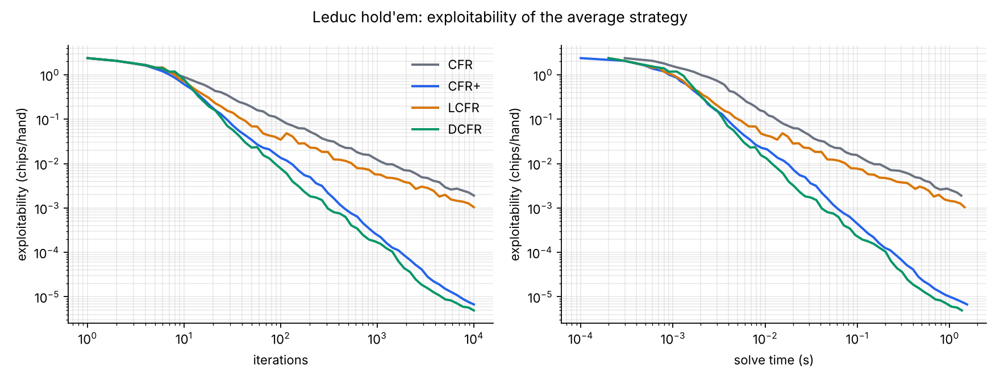
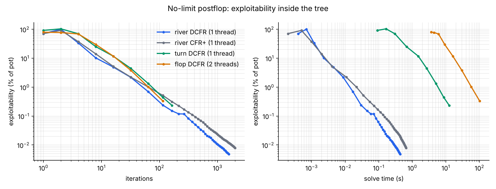

# holdem-cfr

**[Project page](https://tavelarocque.github.io/holdem-cfr/) · [Play the trained bot](https://tavelarocque.github.io/holdem-cfr/web/table/)**

A counterfactual regret minimization (CFR) solver in Rust for heads-up **no-limit** Texas hold'em. It includes a generic CFR engine verified on Kuhn and Leduc poker, a verified 7-card hand evaluator, and a range-vs-range postflop solver with exact exploitability.

**Scope, stated plainly.** Heads-up no-limit has about 10^161 decision points and a continuous bet space, so nobody solves it outright. Strong systems such as Libratus and Pluribus combine three pieces: a coarse abstracted blueprint, real-time subgame solving, and translation of off-tree bet sizes. This project builds the same pieces at laptop scale.

The postflop solver computes equilibria *of a chosen bet-size tree* and reports exact exploitability inside that tree. It does **not** measure exploitability against bet sizes outside the tree, and the full-game bot (M6) is an abstracted approximation, not a solution.

## Status

| Milestone | What | Gate | Status |
|---|---|---|---|
| 0 | Workspace, CI (fmt, clippy `-D warnings`, tests) | CI green | ✅ |
| 1 | `Game` trait, Kuhn poker, vanilla CFR, exact best response | P0 value → −1/18, exploitability → 0 | ✅ |
| 2 | Leduc hold'em, CFR+, Linear CFR, Discounted CFR | 936 infosets; CFR+ ≥10× better than CFR at 1k iters | ✅ |
| 3 | 7-card hand evaluator + benchmarks | matches brute-force reference on all 133,784,560 hands | ✅ |
| 4 | NL river/turn solver: bet tree, vectorized DCFR, O(n) showdowns, exact best response | closed-form polarized river; agrees with scalar engine; mutation-tested | ✅ |
| 5 | Flop solving: rayon multithreading (safe `split_at_mut`), suit isomorphism, per-street sizes, memory budget | parallel bit-identical to serial; isomorphic solve matches full solve | ✅ |
| 6.1 | Perfect hand-isomorphism index (169 / 1,286,792 / 13,960,050 / 123,156,254) + full HUNL rules | flop indexer proven a bijection exhaustively (26M situations); rules property-tested | ✅ |
| 6.2 | Exact hand-strength tables for all 123M river / 14M turn / 1.3M flop classes; E[HS²] percentile buckets (169/50/50/50); multithreaded external-sampling MCCFR | preflop equities match published values (AA 85.20%, 72o 34.58%); MCCFR reaches 0.034 exploitability on Leduc | ✅ |
| 6.3 | No-limit blueprint: abstract betting tree over the real rules (13,704 nodes), 169/50/50/50 buckets, batched Linear-CFR MCCFR trainer with checkpoints | tree legal and consistent; button learns to play strong hands and fold trash | ✅ |
| 6.4a | Duplicate-match arena with 95% CIs vs baselines and earlier checkpoints | harness calibrated (self-play exactly 0); 6-min blueprint beats call +1,428±75, raise +4,011±199, random +2,169±152, equity heuristic +619±180, and its 1-min self +106±30 mbb/hand | ✅ |
| 6.4b | f64 regret and strategy sums (f32 sums had stopped absorbing updates past 2²⁴); blueprint exported to the browser with buckets recomputed from the cards | checkpoints showed 3.4% of the table had lost sub-1 precision at 924M iterations; browser metrics bit-identical to Rust on 660 fixture spots; thresholds reproduce all 138M bucket entries | ✅ |
| 6.5a | Local best response: exact Bayesian range tracking, one-step lookahead, lower bound on exploitability | LBR beats 34M / 408M / 924M / 1,552M checkpoints by +1,143 / +1,207 / +1,100 / +1,389 mbb/hand (±~140): training plateaued early, so the abstraction is the bottleneck | ✅ |
| 6.5b | Real-time re-solving of the turn and river with the exact postflop solver from blueprint ranges; action translation | | — |
| 7 | Play-the-bot CLI, baselines, AIVAT head-to-head, results | | — |

The original plan targeted limit hold'em. It switched to no-limit after M3; the engine, the Leduc work and the evaluator all carry over.

## Results so far

Kuhn poker, vanilla CFR, 100k iterations: game value **−0.055556** (−1/18), exploitability 1.7 × 10⁻⁵, and the learned strategy lands inside the analytic equilibrium family (J bets α, K bets 3α, Q calls α + 1/3).

Leduc hold'em (936 information sets, 9,451 nodes), 10,000 iterations each, single thread:

| Algorithm | Exploitability (chips/hand) |
|---|---|
| CFR | 1.9 × 10⁻³ |
| Linear CFR | 1.0 × 10⁻³ |
| CFR+ | 6.7 × 10⁻⁶ |
| DCFR (1.5, 0, 2) | 4.9 × 10⁻⁶ |

Game value for player 0 converges to **−0.0856**, matching the published value.



### No-limit postflop solver

Give it a board, two ranges, a pot, effective stacks and a bet menu. It returns the equilibrium of that tree for every hand, and exact exploitability as a percentage of the pot.

- **Polarized river, closed form:** nuts and air against bluff-catchers. The solver's call and bluff frequencies match P/(P+B) and B/(P+2B) to within 0.01, for half-pot, pot and 2× pot bets.
- **Cross-check:** the same river and turn spots, expressed through the scalar engine, give the same EV, best-response values and exploitability to within 0.002 chips. The test ranges include card removal, identical combos and ties, and the test catches five injected bugs.

| Spot (2-core VM) | Combos | Public nodes | Memory | Time to target |
|---|---|---|---|---|
| river, 33/75% bets, 60% raises, all-in, 4× pot behind, 1 thread | 256 vs 318 | 63 | 0.1 MB | 0.3% of pot in 0.05 s; 0.005% in 0.4 s |
| turn, same menu, 1 thread → 2 threads | 260 vs 322 | 14,799 | 32 MB | 100 iterations: 9.2 s → 4.8 s (bit-identical) |
| two-tone flop Q♠J♠4♣, 33/66/75% by street, pot raises, all-in, 2 threads | 267 vs 331 | 293,390 | 588 MB | 0.33% of pot in 101 s |
| same flop on a MacBook Air, 8 threads | 267 vs 331 | 293,390 | 588 MB | **0.33% of pot in 31 s** (3.2× faster; identical exploitability digits) |

Speedups come from three sources. Each chance card's subtree is solved in parallel with rayon, in safe Rust via `split_at_mut`, and the results are bit-identical to the single-threaded run. Suit isomorphism is exact and only applies when both ranges are symmetric under the suit swap: on a two-tone turn, 48 rivers become 35, and on a monotone flop, 49 turn cards become 23. Per-street bet menus keep the tree small, and the solver checks the memory a tree needs before allocating it.



### Hand evaluator

A perfect-hash evaluator: rank counts are hashed through a combinatorial number system into a 56,667-entry table, and flushes use a direct 8,192-entry table. The tables total about 125 KB, so they stay in cache. It handles 5, 6 and 7 cards, and hands are built incrementally.

| Check | Result |
|---|---|
| vs brute-force best-of-21, all 133,784,560 7-card hands | 0 mismatches |
| 7-card category histogram | matches the known counts exactly |
| distinct 5-card classes / reachable 7-card classes | 7,462 / 4,824 |

Throughput, single thread, measured on a 2-core cloud VM: about 62M hands/s on random prebuilt hands, about 35M hands/s building from 7 cards and then ranking, and about 50M hands/s enumerating every 7-card hand. Run `cargo bench -p eval` or `holdem-cfr bench-eval` to measure on your own machine.

## Play it

`web/table/` has two modes. **Heads-up vs blueprint** plays you against the actual trained blueprint, exported with `holdem-cfr export-web`. The page recomputes the bot's bucket from the cards (river HS against all 990 opponent hands, turn and flop E[HS²] over every runout, about 50 ms on the flop), with the same summation order and f32 roundings as the Rust tables, so it lands in the same bucket the trainer used; `node web/table/blueprint.test.js` checks this against Rust fixtures. Your bet sizes are the blueprint's own menu, and a results tab tracks bb/100 with a 95% interval.

The **6-max table** is you against five heuristic bots. Preflop they use the exact equities of all 169 starting hands exported from the strength tables. Postflop they estimate equity by Monte Carlo against the ranges each opponent's actions imply, and choose actions by regret matching over rough action values. Each bot's reasoning is shown live. The JS evaluator is checked against the Rust evaluator on 200,000 random hands (`node web/table/core.test.js`), and `node web/table/engine.test.js` plays 3,000 bot hands to check that chips are conserved and that side pots are paid correctly. Rebuild the page with `python3 web/table/build.py`.

## Layout

```
crates/engine   Game trait, compiled tree, CFR / CFR+ / DCFR, best response   (no poker knowledge)
crates/games    Kuhn, Leduc
crates/postflop NL range parsing, public bet tree, vectorized DCFR, exact best response
crates/hunl     full-game rules, hand-isomorphism indexer, strength tables, buckets, blueprint, arena, web export
crates/eval     5/6/7-card hand evaluator + slow reference
crates/cli      `holdem-cfr` binary
scripts/        plotting, walkthrough rendering, the project page (build_overview.py)
web/table/      browser table: heads-up vs blueprint (blueprint.js, hu.js) and 6-max vs heuristic bots (core.js, engine.js)
docs/           milestone walkthroughs (PDF) and papers.md reading list
```

## Usage

```bash
cargo test --workspace
cargo run --release -p cli -- solve --game kuhn --algo cfr --iters 100000 --print
cargo run --release -p cli -- solve --game leduc --algo dcfr --iters 2000
cargo run --release -p cli -- curves --game leduc --iters 10000 --out results/leduc_curves.csv
python3 scripts/plot_curves.py results/leduc_curves.csv results/leduc_exploitability.png "Leduc hold'em"
cargo run --release -p cli -- eval "As Ks Qs Js Ts"
cargo run --release -p cli -- bench-eval
cargo run --release -p cli -- abstraction --out data/buckets.bin   # ~1 min on 8 cores; writes 139 MB
cargo run --release -p cli -- blueprint --minutes 20 --linear-minutes 5  # resumable; prints preflop charts
cargo run --release -p cli -- arena --pairs 100000                       # mbb/hand ± 95% CI vs baselines
cargo run --release -p cli -- blueprint --minutes 30 --reset-average     # keep regrets, rebuild the average
cargo run --release -p cli -- export-web && python3 web/table/build.py    # put the blueprint in the web table
cargo run --release -p cli -- lbr --pairs 25000                          # exploitability lower bound (local best response)
cargo run --release -p cli -- postflop --board "Qs Jh 7c 4d 2s" --oop "22+,ATs+,KQs,AJo+" --ip "random" --pot 100 --stack 400 --bets 33,75 --raises 60 --target 0.05
cargo run --release -p cli -- postflop --board "Qs Js 4c" --oop "22+,A2s+,K9s+,Q9s+,J9s+,T8s+,97s+,87s,76s,65s,ATo+,KTo+,QTo+,JTo" \
  --ip "22+,A2s+,K7s+,Q8s+,J8s+,T8s+,97s+,86s+,75s+,64s+,54s,A8o+,KTo+,QTo+,JTo,T9o" \
  --flop-bets 33 --turn-bets 66 --river-bets 75 --raises 100 --max-raises 2 --target 0.5
cargo bench -p eval
cargo test --release -p eval -- --ignored   # full 133M brute-force check (~2 min)
```

## References

See [docs/papers.md](docs/papers.md) for the reading list, grouped by milestone.
